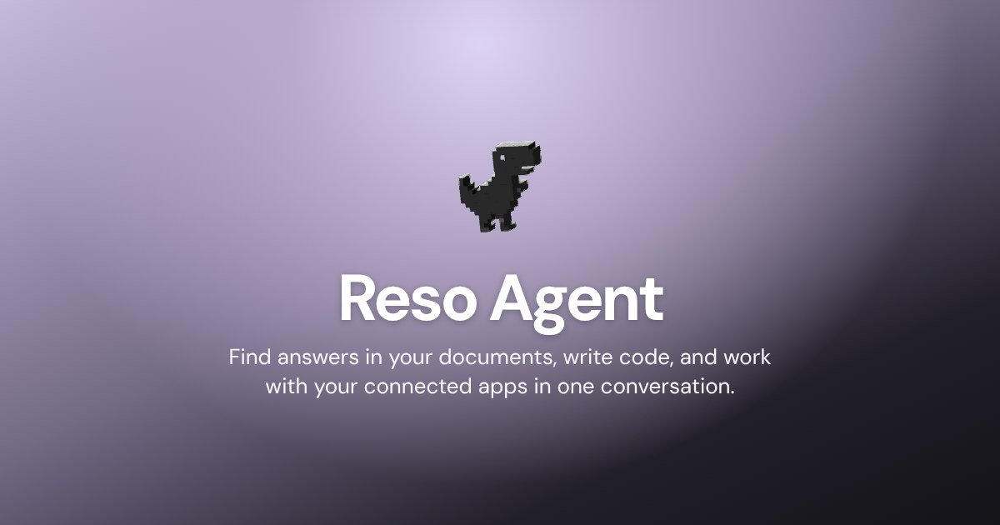

# Reso Agent

Find answers in your documents, write code, and work with your connected apps in one conversation.



Reso Agent pairs a Next.js chat workspace with a Python API. Use **Chat** to talk to your chosen model, or switch to **Agent** when a task needs a tool. For example, you can ask for a summary of an indexed PDF, open the cited page to check the answer, then ask the agent to prepare a GitHub change.

## Run locally

Use Python 3.11 and Node.js 20, matching the project's container images. From a terminal on macOS or Linux:

```bash
git clone https://github.com/rriyansh/RAG-Assistant.git
cd RAG-Assistant
cp .env.example .env
python3.11 -m venv .venv
source .venv/bin/activate
python -m pip install -r requirements.txt
npm --prefix frontend install
```

On Windows, create the environment with `py -3.11 -m venv .venv` and activate it in PowerShell with `.\.venv\Scripts\Activate.ps1`.

For hosted NVIDIA chat, put your `NVIDIA_API_KEY` in the root `.env` and keep `LLM_PROVIDER=nvidia`. This lets visitors use the backend operator's key, subject to its quota and billing. For a personal provider key, start the app and open **Settings → API Keys**.

Start the API in the activated Python environment:

```bash
uvicorn src.api.main:app --reload --port 8000
```

In a second terminal, from the repository root:

```bash
npm --prefix frontend run dev
```

Open the [workspace](http://localhost:3000), complete onboarding, and send a message. Check [API health](http://localhost:8000/health) or browse the [interactive API docs](http://localhost:8000/docs) if the frontend cannot reach the backend.

**Docker alternative.** After configuring `.env`, run `docker compose up --build api frontend`. The web app uses port 3000 and the API uses port 8000. Compose mounts the host's `data/` directory into the API container so its files survive container replacement.

## Working with Reso

| Task | Where to go | What happens |
| --- | --- | --- |
| Choose an identity | Onboarding or Settings → Profile | Pick a user portrait, name your assistant, and choose an agent mascot or upload an image. |
| Set up a model | Settings → API Keys and Model | Configure Chat and Agent separately. Recognizable key prefixes select a provider automatically, and you can select a provider yourself. |
| Connect an app | Settings → Connectors | Search the directory and choose **Connect**. Connected services appear first with controls to disconnect or use them in Agent mode. |
| Review agent work | Agent conversation | Follow tool activity, inspect proposed GitHub changes, and respond to approval prompts for actions that require consent. |
| Keep a response | Actions under an assistant message | Copy text, export a response, or download code extracted from fenced code blocks. |

The connector directory includes **35 entries across five categories**, including two built-in knowledge tools. Each entry describes the operations it exposes. For example, Vercel lists recent deployments, Linear reads assigned issues, and GitHub supports repository search, file reads, issues, and commits. A provider key enables model inference. Each external connector uses separate credentials for its service.

## Ask questions about your documents

1. Put your PDFs in `data/pdfs/`. You can also list source URLs in `data/urls.txt`.
2. Choose an embedding provider in `.env`. The default is Ollama with `nomic-embed-text`. With Ollama running locally, download the model using `ollama pull nomic-embed-text`. Alternatively, set `EMBEDDING_PROVIDER=openai` and supply `OPENAI_API_KEY`.
3. From the activated Python environment, run `python scripts/ingest.py`. The script reads the sources, splits their text into overlapping chunks, computes embeddings, and rebuilds the configured Chroma collection. Keep all sources you want indexed in the input set before rerunning it.
4. In Agent mode, try **“Search my PDFs for the cancellation policy and cite the relevant pages.”** Use the document names and page references to check the result.

Use the same embedding provider and model for indexing and retrieval. If the API runs in Docker and Ollama runs on the host, set `OLLAMA_BASE_URL` to an address reachable **from the container**.

## Technology stack


| Layer | Implementation |
| --- | --- |
| Web workspace | Next.js App Router, React, TypeScript, Tailwind CSS, and Lucide icons |
| HTTP API | Python, FastAPI, Pydantic, and Uvicorn |
| Document search | pypdf extraction, configurable chunking, OpenAI or Ollama embeddings, and persistent Chroma storage |
| Agent tools | Python tool registry, service-specific connector handlers, and GitHub change review |
| Model access | Hosted NVIDIA, user-configured providers, Ollama, and custom OpenAI-compatible endpoints |
| Deployment | Separate API and frontend containers, with shared application data persisted on the backend |

## Configuration and source guide

## Capacitor mobile builds

The mobile workspace is exported as static files from `frontend/` and calls the
FastAPI service directly. Use `scripts/dev.sh` or `scripts/dev.ps1` to start the
API with a Cloudflare Quick Tunnel. For changing tunnel URLs across devices,
configure the optional Gist discovery values in a local, ignored `.env` and set
`NEXT_PUBLIC_BACKEND_CONFIG_URL` once in Vercel and GitHub Actions. The device
also accepts a manual URL in Settings → Backend Connection. See
[docs/mobile-deployment.md](docs/mobile-deployment.md).

GitHub Actions builds an Android debug APK and an unsigned iOS IPA on pushes to
`main`, publishes GitHub Releases, and uploads Capgo OTA bundles when the
`CAPGO_TOKEN` repository secret is configured. The iOS IPA needs signing before
installation. Changes to native plugins or permissions require a new native
build; OTA applies web assets only.

| Setting | Where to set it | Purpose |
| --- | --- | --- |
| `LLM_PROVIDER`, `NVIDIA_API_KEY`, `NVIDIA_MODEL` | Backend environment | Select the hosted inference provider and model. Keep the operator's key server-side. |
| `EMBEDDING_PROVIDER`, `CHROMA_PERSIST_DIR` | Backend and ingestion environment | Choose the embedding service and local index location. |
| `RAG_BACKEND_URL` | Frontend server environment | Point Next.js API requests at the FastAPI service when deploying separately. |
| `SITE_URL` | Frontend server environment | Set the public origin used in sharing metadata, robots.txt, and sitemap.xml when a canonical deployment URL is needed. |
| `NEXT_PUBLIC_SUPABASE_URL`, `NEXT_PUBLIC_SUPABASE_ANON_KEY` | Frontend build environment | Enable Supabase Auth / Google Login. Leave blank to keep anonymous/local mode. |
| `CAPGO_TOKEN` | GitHub Actions secret only | Publish Capgo OTA bundles. OTA is gracefully skipped when unset. |

See the [configuration template](.env.example) for model, retrieval, and chunking settings. The [web workspace](frontend/), [API routes](src/api/), [agent tools](src/agent/), and [ingestion script](scripts/ingest.py) are the main entry points for development. Run `npm --prefix frontend run build` to check the production frontend build.

## Authentication & onboarding flow

Reso Agent works without an account. On first launch the onboarding modal asks for a name, default workspace mode (Chat or Agent), and an optional LLM provider key. Users can skip the key and still use the configured hosted provider (for example the operator's NVIDIA NIM tier).

### Google Login (optional)
When `NEXT_PUBLIC_SUPABASE_URL` and `NEXT_PUBLIC_SUPABASE_ANON_KEY` are set, a **Sign in with Google** button appears as an early onboarding step. Signing in:
- Creates/restores a Supabase session that persists in the browser and across Capacitor mobile sessions.
- Links the local profile to the authenticated user id (`supabaseUserId`) without replacing the name/mode/provider setup.
- Keeps anonymous/local mode fully available for users who skip auth.

### GitHub Login (optional)
When the same Supabase variables are set, a **Sign in with GitHub** button also appears alongside Google. It works identically, authenticating through GitHub via Supabase OAuth.

To enable either (or both):
1. Create a Supabase project and copy the project URL and `anon` (public) key into `NEXT_PUBLIC_SUPABASE_URL` / `NEXT_PUBLIC_SUPABASE_ANON_KEY`.
2. In Supabase, go to Authentication → Providers, enable Google and/or GitHub, and enter each provider's OAuth client ID/secret.
3. Add your OAuth redirect callback URL (e.g. `https://your-app.com/auth/callback`) to both the provider's console redirect URIs and Supabase's redirect URL allowlist.
4. Rebuild/redeploy the frontend so the values are embedded in the static bundle.

### Logout
Settings → Account & Security → **Sign out** clears the Supabase session, removes local conversation history, resets the profile, and re-opens onboarding so the user can sign in again or continue anonymously. No keys or tokens are stored in the client bundle or git.

## Production / OTA / Auth setup

### Build and deploy
- Frontend: Next.js static export (`output: "export"`) to `frontend/out`. Host on Vercel, Cloudflare Pages/Workers, or any static host.
- Backend: FastAPI (`src.api.main:app`) behind Uvicorn, on port `PORT` (default `8000`). Persists Chroma indexes and settings under `CHROMA_PERSIST_DIR` (`data/`).
- Mobile: Capacitor wraps the static web bundle for Android/iOS.

### Capgo OTA
The `build-mobile` GitHub Actions workflow exports the frontend bundle, builds native Android/iOS binaries, publishes a GitHub Release, and—when the `CAPGO_TOKEN` repository secret is set—uploads the web bundle to Capgo's `production` channel with auto-bump. Existing installed apps receive the web assets on launch; the native binary is unchanged.

- `CAPGO_TOKEN` is never embedded in the client bundle. It is a GitHub Secret used only by CI.
- When `CAPGO_TOKEN` is missing, OTA upload is skipped with a clear log message; native builds and releases continue.
- Web-asset-only changes (UI, chat, onboarding, auth UI) ship via OTA without a new native binary.
- Changes to Capacitor plugins, permissions, app id, or native config require a new native binary build and store update; OTA cannot patch native code.

Register `com.rriyansh.ressoagent` in Capgo and create the default `production` channel before the first upload. See `docs/mobile-deployment.md` for details.

### Secrets never committed
Provider API keys (`OPENAI_API_KEY`, `GROQ_API_KEY`, `NVIDIA_API_KEY`, etc.), `GH_GIST_TOKEN`, and `CAPGO_TOKEN` must be set as runtime environment variables or GitHub/CI secrets. `.env` is ignored by git; only `.env.example` (placeholders only) is committed.

## License

Released under the [MIT License](LICENSE).
